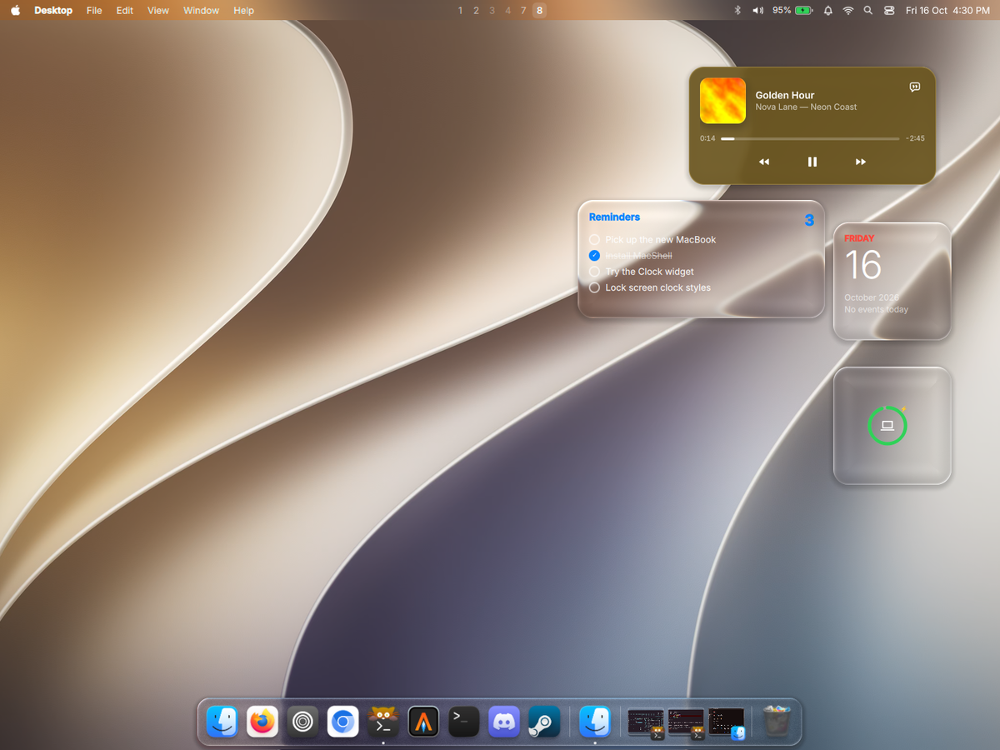
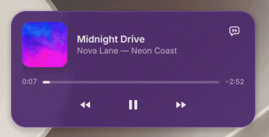
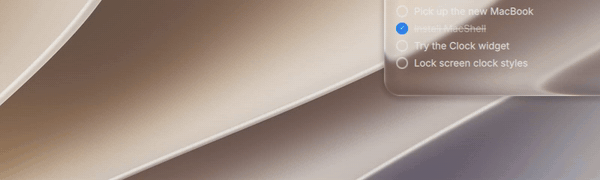
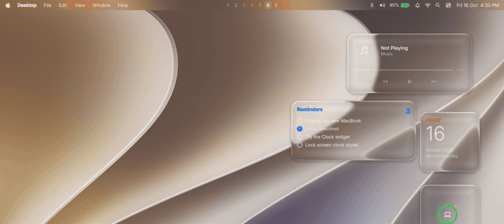
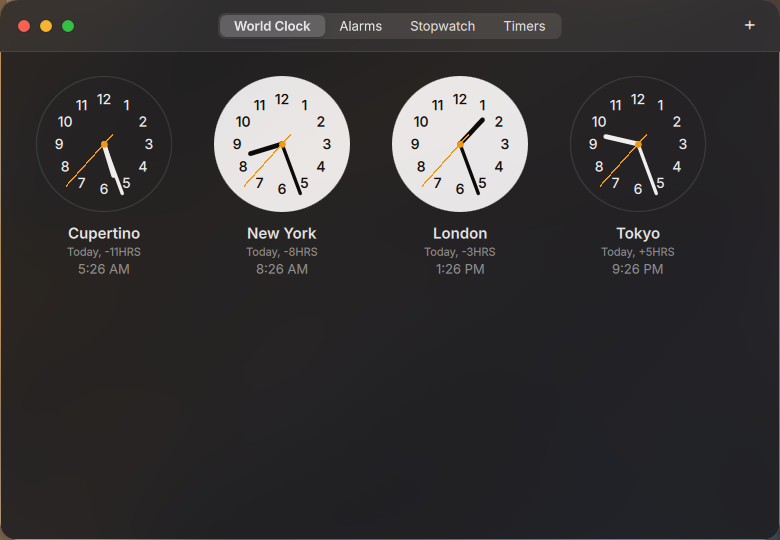
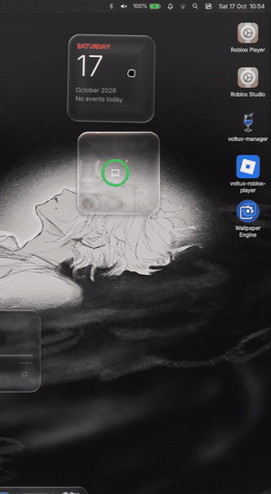
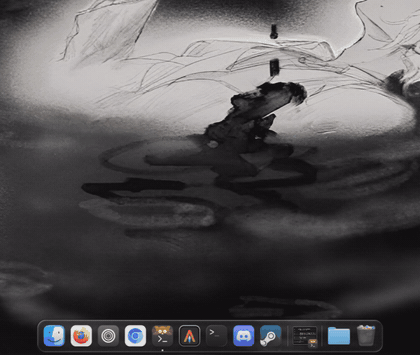
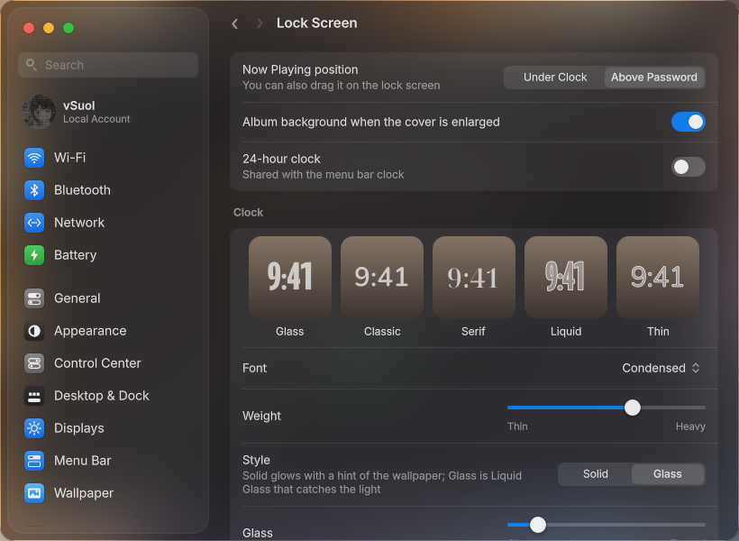

# MacShell — Tahoe edition

A macOS 26/27-style desktop for **Hyprland**, built on **Quickshell**: Liquid Glass menu bar, Dock, Control Center,
Spotlight, desktop widgets, notifications and a full lock screen. This is a fork of
[0-ss/Macshell](https://github.com/0-ss/Macshell) with a lot added on top (see below). The original README follows.



| Music widget: cover "burns" over while the album colour spreads | App switcher (Alt + Tab): gliding highlight, morphing name |
|---|---|
|  |  |

| Lock screen | Clock app |
|---|---|
|  |  |

| Control Center: tiles stagger in, every module animated | A folder pinned to the Dock fans out |
|---|---|
|  |  |



## Performance

Measured on an Intel laptop (Hyprland 0.56, Quickshell 0.3, two monitors, 60 Hz + 164 Hz, Liquid Glass on):

| | RAM (resident) | CPU at idle |
|---|---|---|
| MacShell (menu bar, Dock, widgets, everything) | ~550–680 MB after start (was ~1.1 GB) | ~3–5 % of one core (was ~7.6 %) |
| Lock screen while locked | ~360 MB | ~0 % |

What made the difference: one variable Inter font file instead of a 13 MB collection mapped once per weight, `MALLOC_ARENA_MAX=2`,
Settings and Clock content only built while open, blurred backdrops at half resolution, desktop widgets culled while windows
cover the desktop, the Dock's glass refreshing nearby windows at 15 fps instead of every frame, window-title changes and the
shell's own captures no longer waking the 60 Hz geometry poll, and animations at each monitor's real refresh rate
(`QSG_USE_SIMPLE_ANIMATION_DRIVER=1`, otherwise Qt paced everything to the 60 Hz panel).

## Install

```sh
git clone -b tahoe https://github.com/vsoultann/MacShell.git
cd MacShell
./install.sh            # interactive
./install.sh --all -y   # everything, no questions
```

Run it with no options for the interactive menu: it notices an existing install (the original MacShell or this edition)
and offers to update it or install everything, or lets you tick exactly the features you want.

| Command | What it does |
|---|---|
| `./install.sh` | Interactive: Install / Update / Check / Uninstall, then a checklist of features |
| `./install.sh --all` | Everything |
| `./install.sh --only shell,lock` | Just the features you name |
| `./install.sh --update [features]` | Pull the latest version, then update (default: shell, lock, config) |
| `./install.sh --uninstall [features]` | Remove everything, or just some features (settings are kept) |
| `./install.sh --check` | What's installed and what's missing |

Features: `shell` (menu bar, Dock, Spotlight, Control Center, notifications, widgets, Clock, Settings), `lock` (lock screen),
`config` (session config + scripts), `session` (separate "Hyprland (MacShell)" login), `existing` (start from your own Hyprland
config instead), `deps`, `icons`, `fonts`, `apply`, `wallpapers`, `sounds`.

Settings live in the shell itself: Apple menu → **System Settings…** (Install dependencies and Reset MacShell are in About / General).

## What this fork adds to the original

The original MacShell is the menu bar, the Dock and the Liquid Glass shader. Everything below is new in this fork:

**New apps & screens**
- **Finder** — sidebar with favourites and colour tags, list and icon views, coloured folders, search, new folder, trash,
  Quick Look (pictures, text, PDF and video in our own player), **Merge Photos** (grid, side by side or stacked),
  and pinning a folder to the Dock, where it fans its contents out in an arc.
- **Photos** — your library grouped by day, folders as albums, favourites, a zoom slider and a full-screen viewer.
- **AirDrop** — the radar, the devices around you, drag-to-send. It speaks LocalSend's protocol, so phones, tablets and
  other desktops running LocalSend appear here and can receive from here.
- **App Store** — Flathub, laid out like the real App Store: Discover, categories, screenshots, search and updates.
- **Welcome** — runs once after installing: hello in thirty-odd languages, your name and picture, then the material
  (Liquid Glass, Frosted, Blur, Opaque) with a live preview and an amount slider.
- **Desktop icons** — everything in ~/Desktop, drag and snap to the grid, double-click to open, drop one onto another
  to make a folder, rename and trash from the menu.
- **Video player** — a QuickTime-looking player with a glass control bar, used by Quick Look and previews.
- **Lock screen (MacLock)** — its own process (a shell crash can't take the lock down), PAM unlock, glass clock that stretches
  like iOS 26's, Caps Lock indicator, animated wallpapers, per-character password dots, and:
  - **Now Playing** bubble tinted from the album art, shuffle / repeat, synced lyrics (in the bubble or side by side),
    enlarge-the-cover artwork mode with a blurred album background, drag the bubble between two spots.
  - **Notifications, hidden** like macOS ("previews when unlocked"): app icon, app name, time. Clicking one makes the
    password field glow.
  - **Live activity**: a running timer or stopwatch, or a ringing alarm with Stop / Snooze.
- **Clock app** — World Clock (day / night faces), Alarms (repeat days, snooze, on/off), Stopwatch with laps, Timers with a
  progress ring. Alarms ring even with the window closed, and everything survives restarts.
- **System Settings** rebuilt like macOS: Wi-Fi (with Ethernet), Bluetooth, Network, Battery & Energy Mode, Control Center,
  Desktop & Dock, **Displays** (main display, resolution, refresh rate, with the macOS "keep or revert" countdown) & Night Shift,
  Notifications, Sound, Focus, Lock Screen, Users & Groups, Keyboard, Mouse, Trackpad, Wallpaper, Reset, Install dependencies.
  macOS pop-up menus and controls throughout.
- **Desktop widgets** — Clock, World Clock, **Clock (timer / stopwatch / alarms with switches)**, Calendar, Weather, Batteries, Music,
  Notes, Photos, Reminders, Stocks; Liquid Glass / Frosted / Tinted / Opaque, drag, resize with motion-morph, glass that follows
  a live wallpaper.

**Dock**
- Live window previews next to the Trash that keep running while other apps open and close.
- Items grow in when an app opens and shrink out when it closes.
- Pull a window preview out of the Dock: it grows into the window, then the real window follows your pointer until you let go.
- Pull an app icon onto the desktop to open it.

**Everywhere**
- **One material for the whole system** — Liquid Glass, Frosted, Blur or Opaque applies to the menu bar, Dock, Control Center,
  notifications, Spotlight, the paste menu and the widgets at once, and refraction is **real-time**: whatever moves under a
  panel is refracted as it moves.
- **Notifications** — Liquid Glass banners that morph into Notification Center and disintegrate on Clear All.
- **Animated wallpapers** that stay cheap: an optimized copy decoded on the iGPU, paused while windows cover the desktop or the screen is locked.
- Blur + morph text transitions, auto contrast (panels switch text color only when it would be unreadable), Spotlight glow,
  Game Mode, UI sounds, drag clipboard items onto the desktop.
- State that survives a crash (Do Not Disturb, Night Shift, alarms, timers, …), about 4 % CPU when idle.
- A CLI installer with an interactive menu, a separate login session option, `--update`, `--check` and `--uninstall`.

## Contributors

- **[@0-ss](https://github.com/0-ss) (Rickky)** — original author of MacShell: the menu bar, the Dock, the Liquid Glass shader and
  the foundation everything here is built on, plus help along the way. Their commits are part of this repository's history.
- **[@vsoultann](https://github.com/vsoultann)** — this fork (Tahoe edition).

## Credits

- [0-ss/Macshell](https://github.com/0-ss/Macshell) — the original MacShell (menu bar, Dock, Liquid Glass shader). All credit for the base goes there.
- The session config started from [end-4/dots-hyprland](https://github.com/end-4/dots-hyprland) (GPL-3.0).
- [MacTahoe icon theme](https://github.com/vinceliuice/MacTahoe-icon-theme) by vinceliuice (GPL-3.0) — `assets/music-app.svg` comes from it.
- [Roboto Flex](https://github.com/googlefonts/roboto-flex) (OFL) and [Inter](https://rsms.me/inter/) (OFL), downloaded by the installer.
- Lyrics: [LRCLIB](https://lrclib.net) and NetEase Cloud Music. Weather: [Open-Meteo](https://open-meteo.com).
- Apple's wallpapers belong to Apple and are not included — `--wallpapers` downloads them.

---

# MacShell

A macOS Tahoe–style **menu bar + Dock** for Hyprland, built on [Quickshell](https://quickshell.org), with a real-time
"Liquid Glass" refraction shader, window previews, Spotlight, clipboard/emoji picker, notifications, Control Center,
screenshots,record video, a wallpaper picker and an Alt+Tab switcher — all in one Quickshell process.

> **Heads up:** this targets **Hyprland 0.55+ with a Lua config** (`hyprland.lua`) and a recent **Quickshell (0.3.x)**.
> See [Requirements](#requirements) and [Known issues](#known-issues).

## Files

| File | Purpose |
|---|---|
| `shell.qml` | Entry point. Shared hub: window geometry, wallpaper lookup, capture gating. |
| `MacBar.qml` | Menu bar, Control Center, Spotlight, notifications, switcher, screenshots, wallpaper picker. |
| `MacDock.qml` | Dock, window previews, and the Settings window. |
| `liquidglass.frag` | Liquid Glass fragment shader (compiled to `.qsb` on first run). |
| `EmojiData.js` | Emoji fallback data for Spotlight (from [gemoji](https://github.com/github/gemoji), MIT). |

Keep all five files in the same folder.

## Requirements

### Required

| What | Why |
|---|---|
| **Hyprland ≥ 0.55, running a Lua config** (`~/.config/hypr/hyprland.lua`) | Window actions, the Alt+Tab focus, "paste after picking" and Log Out use Lua dispatches (`hyprctl dispatch 'hl.dsp…'`, `hyprctl eval`). On older versions or a `.conf` session these actions fail; the bar, Dock, glass and previews still work. Quick test: `hyprctl dispatch 'hl.dsp.no_op()'` must not error. |
| **Quickshell ≥ 0.3.0** (0.3.2 recommended) | Needs the Hyprland module (`HyprlandToplevel`, `lastIpcObject`, Lua-config support), `ScreencopyView`, `IpcHandler`, and the UPower / Pipewire / Mpris / SystemTray / Notifications services. |
| Quickshell built with **Wayland**, **Hyprland**, **Screencopy → Hyprland Toplevel Export**, **Pipewire**, **UPower**, **Mpris**, **System Tray** | Distro packages normally enable all of these. Check the build info that `qs` prints in its logs. |
| **Qt 6.5+** with `qt6-declarative`, `qt6-wayland`, **`qt6-shadertools`** (provides `qsb`) | `QtQuick.Effects` (MultiEffect) needs 6.5+. `qsb` compiles `liquidglass.frag` on first run. Without it (and without a prebuilt `liquidglass.frag.qsb`) the glass falls back to "Normal Blur". |
| `qt6-svg` (recommended) | SVG app icons. |
| `hyprctl`, `sh`, `xdg-open` | Core. |
| An **icon theme** (Papirus, Adwaita, …) set for Qt apps | App icons in the Dock and Spotlight come from the system theme. If icons are blank, set one with `qt6ct` or `QS_ICON_THEME`. |
| Font **Inter** (default) | Falls back to the system font; "Noto Sans" / "System" can be chosen in Settings. |

### Optional (missing tools just disable that feature)

| Feature | Tool(s) |
|---|---|
| Screenshots (Print key) | `grim`, `wl-clipboard` (clipboard copy), `libnotify` (`notify-send`) |
| Clipboard history + Emoji (Spotlight) | `wl-clipboard`, `cliphist` (the shell starts the `wl-paste --watch cliphist store` watchers itself) |
| Screen recording | `wf-recorder` |
| Color picker | `hyprpicker` |
| Night Shift | `hyprsunset` |
| Brightness | `brightnessctl` |
| Wi-Fi / VPN / Ethernet | NetworkManager (`nmcli`); fallback editor `nm-connection-editor` or `nmtui` |
| Bluetooth | `bluez` (`bluetoothctl`) |
| Audio device routing | `wpctl` (WirePlumber) or `pactl` |
| Privacy indicators | PipeWire (`pw-dump`) |
| Keep Awake | `systemd-inhibit` |
| Lock / Sleep / Restart / Shut Down | `loginctl`, `systemctl` (UWSM sessions are stopped via `uwsm`) |
| Trash watching / emptying | `inotify-tools` (`inotifywait`), `ktrash6`/`ktrash5`, or a file manager (`dolphin`, `nautilus`, `thunar`, `nemo`, `pcmanfm-qt`) |
| Folder pickers in Settings | `zenity`, `kdialog` or `yad` |
| "About This Linux" | `fastfetch` or `neofetch` |
| Do Not Disturb (Focus) | `dunstctl`, `makoctl` or `swaync-client` (only if you keep one of those) |
| Emoji search keywords | `emoji-test.txt` from the `unicode-emoji` package (otherwise `EmojiData.js` is used) |
| Wallpaper detection / applying | one of: Noctalia, `awww`/`swww`, `hyprpaper`, `swaybg`, `wpaperd` — or set a path yourself (see [Wallpaper](#wallpaper)) |
| Default apps | terminal `kitty`, file opener `xdg-open` — change `terminal`, `launcher`, `filesCmd`, `clipboardCmd` in `~/.config/macbar/settings.json` |
| Video in the player and in Finder's Quick Look | `qt6-multimedia` (with `qt6-multimedia-ffmpeg`); hardware decoding through VA-API |
| The AppleCare+ easter egg | `yt-dlp` (without it the video opens in your browser instead) |
| PDF previews in Quick Look | `poppler` (`pdftotext`) |
| Merge Photos in Finder | `imagemagick` (`magick`, `montage`) |
| Picking files to send in AirDrop | `zenity` |
| AirDrop itself | `python3` (standard library only) and a device running [LocalSend](https://localsend.org) on the same network |
| Apple Music | [Cider](https://cider.sh) (`cider`), by the Cider Collective — installed as `macshell-applemusic.desktop` |
| App Store | `flatpak` with Flathub added (`flatpak remote-add --if-not-exists flathub …`) |

### Conflicts

This shell **replaces** your bar, dock and notification daemon. Stop anything that overlaps:

- Other bars/shells (waybar, hyprpanel, ags, Noctalia, Caelestia, …) and docks (nwg-dock, …).
- Notification daemons (`dunst`, `mako`, `swaync`): the bar owns `org.freedesktop.Notifications`.
  `systemctl --user disable --now dunst` (or `mako` / `swaync`).

## Install

1. Install the requirements above. On Arch, for example:
   ```sh
   sudo pacman -S hyprland quickshell qt6-declarative qt6-wayland qt6-shadertools qt6-svg \
        grim wl-clipboard wf-recorder cliphist libnotify brightnessctl networkmanager bluez-utils inotify-tools \
        ttf-inter noto-fonts-emoji
   ```
   Other distros: install the equivalents. Fedora has a Quickshell COPR; Nix has `pkgs.quickshell`.
2. Put the project in a Quickshell config folder. The folder name is the config name:
   ```sh
   git clone https://github.com/0-ss/MacShell ~/.config/quickshell/MacShell
   ```
   Don't reach it through a symlink; Quickshell ≥ 0.3 derives its state folders from the link path.
3. Try it:
   ```sh
   qs -c MacShell (or use qs -c ~/.config/quickshell/MacShell)
   ```
   On first run with the Liquid Glass style, `liquidglass.frag` is compiled with `qsb` and cached in
   `~/.config/macdock/liquidglass.frag.qsb`. Watch for `[macbar-glass] state: ready` in the log.
4. Add the Hyprland config below, then autostart it.

## Hyprland configuration (Lua)

```lua
-- autostart (remove other bars / docks / notification daemons first)
hl.on("hyprland.start", function()
    hl.exec_cmd("qs -c macshell")
end)

-- layer rules: blur for the glass surfaces
hl.layer_rule({ name = "macdock",  match = { namespace = "macdock"  }, blur = true, ignore_alpha = 0.2,  no_anim = true })
hl.layer_rule({ name = "macspot",  match = { namespace = "macspot"  }, blur = true, ignore_alpha = 0.05, no_anim = true })
hl.layer_rule({ name = "macbarbg", match = { namespace = "macbarbg" }, blur = true, ignore_alpha = 0.05, no_anim = true })
hl.layer_rule({ name = "macshot",  match = { namespace = "macshot"  }, no_anim = true })   -- optional: no fade on the screenshot picker

-- Settings window (fixed size). Hyprland usually floats it on its own; if it tiles, add a float rule for the title
-- "macshell Settings" (see /usr/share/hypr/hyprland.lua for the window_rule syntax of your version).

-- keybinds (the name after -c must match your folder name)

hl.bind("SUPER + V",         hl.dsp.exec_cmd(qs .. "spotlight clipboard"))
hl.bind("SUPER + period",     hl.dsp.exec_cmd("qs -c ~/.config/quickshell/MacShell ipc call spotlight emoji"))
hl.bind("SUPER + Space",     hl.dsp.exec_cmd("qs -c ~/.config/quickshell/MacShell ipc call spotlight toggle"))
hl.bind("ALT + TAB",     hl.dsp.exec_cmd("qs -c ~/.config/quickshell/MacShell ipc call switcher next"))
hl.bind("CTRL + ALT + W",     hl.dsp.exec_cmd("qs -c ~/.config/quickshell/MacShell ipc call wallpapers toggle"))
hl.bind("PRINT",     hl.dsp.exec_cmd("qs -c ~/.config/quickshell/MacShell ipc call screenshot region"))
```

Also make sure **blur is enabled** in your Hyprland `decoration` settings, or the "Normal Blur" style won't blur.

### IPC reference

`qs -c macshell ipc call <target> <function>`

| Target | Functions |
|---|---|
| `spotlight` | `toggle`, `clipboard`, `emoji`, `apps` |
| `screenshot` | `region`, `screen`, `window` |
| `wallpapers` | `toggle`, `open`, `close` |
| `switcher` | `next`, `prev`, `commit`, `cancel` |
| `settings` | `open` (works even if both the bar and the Dock are disabled) |
| `glass` | `captures true\|false` (window previews on/off, same as Settings → Dock Behavior → *Live window capture*) |
| `finder` | `open`, `folder <path>` |
| `photos` | `open`, `folder <path>` |
| `airdrop` | `open` |
| `appstore` | `open`, `search <query>`, `page <id>` |
| `player` | `play <path\|url>`, `youtube <url>` |
| `welcome` | `open` (the first-run screen; it runs itself once unless `~/.config/macshell/welcome-done` exists) |
| `desktop` | `toggle`, `refresh` (icons on the desktop) |
| `dock` | `pinfolder <path>`, `unpinfolder <path>`, `stack <path>` |
| `controlcenter` | `toggle`, `open`, `close` |
| `notifications` | `open`, `close`, `clear`, `dismiss <id>`, `dnd on\|off\|toggle` |

## Wallpaper

The Liquid Glass refracts your wallpaper, so the shell needs its file path. It looks, in order, at: the `wallpaperPath`
override in `settings.json`, Noctalia's `settings.toml`, `awww`/`swww query`, `hyprctl hyprpaper listactive`, and
`~/.config/hypr/hyprpaper.conf`. If yours isn't detected (swaybg, wpaperd, a custom script), either pick a wallpaper in the
built-in picker (Ctrl+Alt+W; it remembers the path), or set `"wallpaperPath": "/path/to/image.png"` in
`~/.config/macdock/settings.json`. The picker reads `~/Pictures/Wallpapers` by default (`wallpaperDir`).

## Where things are stored

| Path | Content |
|---|---|
| `~/.config/macbar/settings.json` | Menu bar settings |
| `~/.config/macdock/settings.json`, `pinned.json` | Dock settings and pinned apps |
| `~/.config/macdock/liquidglass.frag.qsb` | Compiled shader cache |
| `~/.cache/macbar/` | Clipboard history helper files (images, timestamps) |
| `~/Pictures/Screenshots` | Default screenshot folder |

Clipboard history is kept on disk (cliphist's database plus `~/.cache/macbar/clip`). Turn it off with `clipHistory: false`
in `~/.config/macbar/settings.json` if you don't want that.

## Troubleshooting

| Symptom | Check |
|---|---|
| Glass looks flat / "Normal Blur" | `qsb` missing (install `qt6-shadertools`) — the log shows `[macbar-glass] state: failed`. Or ship a prebuilt `liquidglass.frag.qsb` next to `liquidglass.frag`; it is used as a fallback. |
| Glass shows no wallpaper | Wallpaper not detected: see [Wallpaper](#wallpaper). |
| Blank app icons | No Qt icon theme: set one (`qt6ct`, or `QS_ICON_THEME`) and install it. |
| No notifications | Another daemon owns the D-Bus name. Disable it and restart the shell. |
| Window menu actions, Alt+Tab focus, paste-after-pick or Log Out do nothing | Not on a Lua-config Hyprland 0.55+: run `hyprctl dispatch 'hl.dsp.no_op()'`. |
| No window previews / glass behind windows | Quickshell built without Hyprland Toplevel Export, or Settings → Dock Behavior → *Live window capture* is off. |
| Log | `qs log` (see `qs --help` for selecting the config). |

## Known issues

**Shell crash with `wl_display#1: error 0: invalid object NNN`** when many windows open/close quickly (a game launching,
spamming terminals) while live window capture runs. A window closes while a capture frame for it is still pending; Hyprland
does not answer that frame, the shell then destroys it, and the compositor drops the Wayland connection. Mitigations:

- Settings → Menu Bar → turn **Real-time glass** off (far fewer captures; the biggest win).
- Settings → Dock Behavior → turn **Live window capture** off.
- The shell already pauses glass captures while windows open/close.
- Auto-restart it: `sh -c 'while :; do qs -c macshell; sleep 1; done'` as the autostart command.

Glitchy window capture,
Can be disabled in Settings:

- Settings → Dock Behavior → turn **Live window capture** off.

Reproduced on Hyprland 0.56.2 / Quickshell 0.3.2

## Credits

Emoji data from [GitHub gemoji](https://github.com/github/gemoji) (MIT).
